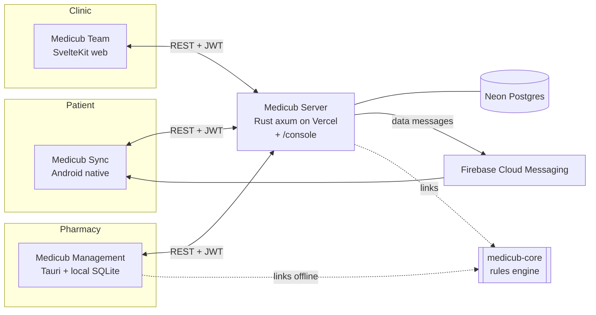

# 02 · Architecture

## System map

## Technology decisions

| Concern | Choice | Why |
|---|---|---|
| Server | Rust, axum 0.8, tokio, sqlx (Postgres) | Matches our Rust strength; the rules engine is shared with the desktop app |
| Hosting | Vercel Rust runtime (**public beta**) via `vercel_runtime` with its `axum` feature | Single deployment target the brief asked for |
| Database | Neon serverless Postgres (pooled connection string) | Vercel functions are stateless; no local files |
| Shared logic | `crates/medicub-core`, pure Rust, no IO | Same code decides on server and offline at the chemist |
| Patient app | Kotlin, Jetpack Compose, Room, WorkManager, Hilt | Native APIs for alarms, notifications, camera, Health Connect, NFC |
| Doctor app | SvelteKit (Svelte 5) + TypeScript + Tailwind, `adapter-vercel` | Fast to build, zero install, tablet friendly |
| Pharmacy app | Tauri v2 + SvelteKit (static) + Rust backend + SQLite | Offline-first desktop, native file watching, OS notifications |
| Push | FCM HTTP v1 (Android), polling + OS notifications (web, desktop) | No websockets on serverless |
| Contract | OpenAPI 3.1 in `contract/openapi.yaml` | Parallel agents need one source of truth |

## Vercel constraints the server must respect

Vercel's Rust runtime is in **public beta**, so treat the first deploy as a spike (see `docs/08`).

- **Stateless:** no in-memory sessions, queues, or caches that matter. Everything durable goes to Postgres.
- **No websockets / long-lived streams:** clients poll; push goes through FCM.
- **Short-lived connections:** use Neon's *pooled* connection string; keep `sqlx` pool small (≤ 5).
- **Cold starts:** keep the binary lean; no heavy init; lazy-load the drug catalog.
- **Migrations are not run at request time.** Run `sqlx migrate run` from CI or a local command.
- **Workspace caveat:** older community Rust runtimes failed on Cargo workspaces. Verify that the official runtime builds the server with its `medicub-core` path dependency during the Day-0 spike. Fallbacks, in order: (a) point the build at the server member via `vercel.json` build settings, (b) vendor `medicub-core` into `apps/server` as a path crate, (c) deploy the same axum app from a Docker image (Vercel has a Rust-with-Docker guide) or any container host.
- Background work after a response uses the runtime's `waitUntil`-style awaiter, not detached tasks.

## Core flows

### A. Consent (patient shares records with a clinician or pharmacist)

1. Patient opens **Share** in Sync → `POST /v1/consents/codes` with scope (`clinic` or `dispense`) → short code + expiry (5 min).
2. Sync shows the code as a QR (`medicub://consent/<code>`) after biometric confirm.
3. Doctor (Team) or pharmacist (Management) scans or types it → `POST /v1/consents/redeem` → time-bound **grant** (e.g., 2 h).
4. Patient gets a notification "Dr Iyer can view your medicines until 7:40 pm", with Revoke.
5. Every patient-data read goes through the **consent middleware**: role + active grant + scope, else 403. Every grant, read of a summary, and revoke is audited.

### B. Prescribing with live safety check

1. Doctor composes a draft → `POST /v1/prescriptions/{id}/check` runs `medicub-core` against the patient's **current regimen** (all prescribers) and returns *preview flags*.
2. UI shows flags inline. Doctor adjusts or records a decision on each preview flag.
3. `POST /v1/prescriptions/{id}/sign` is rejected (409) while any HIGH/CRITICAL flag lacks a decision. On success: content hash, `rx_code`, audit entry, regimen update, patient notification.
4. Flags that remain relevant become persistent `flags` rows routed to the right role.

### C. Dispensing and substitution

1. Pharmacist redeems the patient's `dispense` consent and opens the prescription by `rx_code`.
2. For each item, they scan (GS1 / EAN) or type the product in hand. `POST /v1/dispenses/{id}/scan` (or the same check locally via core when offline).
3. Result:
   - **EquivalentCandidate** (same ingredient set, same strengths, same form): pharmacist attests; recorded.
   - **Mismatch / Unknown / Duplicate / Interaction**: dispensing of that item is **blocked**; the system creates a flag routed to the prescriber with an Approve/Reject card.
4. Prescriber decides in Team; Management receives it (poll + desktop notification); the dispense can proceed or the item is changed by a new prescription. All audited.

### D. Adherence and vitals

Sync schedules doses locally. Dose events (`taken | missed | skipped | snoozed`) are written to Room and synced idempotently. Caregiver notifications for missed doses go through the server. Vitals carry `device_class` (`validated_cuff | manual | wearable_estimate`); only the first two can drive alerts, after a reliability score ≥ threshold.

### E. Notifications

| Kind | Origin | Delivered to | Channel |
|---|---|---|---|
| `DOSE_DUE` | Local (AlarmManager) | Patient | Local notification (works offline) |
| `RX_SIGNED` | Server | Patient | FCM |
| `CONSENT_GRANTED` / `CONSENT_REVOKED` | Server | Patient, grantee | FCM / poll |
| `FLAG_RAISED` | Server | Prescriber/team, pharmacist (if dispense), patient (plain language) | poll + OS notif / FCM |
| `FLAG_RESOLVED` | Server | All parties | poll / FCM |
| `DISPENSE_BLOCKED` | Server | Pharmacist, prescriber, patient | poll / FCM |
| `PATIENT_ARRIVED` | Server | Clinic team | poll + browser notification |
| `MISSED_DOSE_CAREGIVER` | Server | Caregiver | FCM |
| `CUFF_RECHECK_PROMPT` | Local | Patient | Local notification |

FCM **data messages only**; the app builds the notification itself so it can localise, pick the channel, and attach actions.

### F. Offline behaviour

| App | Offline guarantee |
|---|---|
| Sync | Schedule, reminders, logging doses, viewing records work offline. Outbox syncs later (idempotency keys). |
| Management | Inventory ledger, dispense checks (core + cached catalog + cached regimen snapshot) work offline. Escalations queue and send on reconnect, and the UI says so clearly. |
| Team | Online only. Show clear connection state; never silently lose a decision. |

## Security and privacy basics

- Passwords with Argon2id; JWT access (15 min) + refresh (7 days); role in claims.
- Role × scope checks in one middleware, not scattered across handlers.
- Audit log is append-only and hash-chained (`entry_hash = sha256(prev_hash ‖ canonical_json(entry))`); `/v1/audit/verify` recomputes the chain.
- No patient data in logs, push payloads, or URLs. Push carries IDs and a title key only.
- CORS allowlist; request size limits; rate limits on auth and consent redemption.
- Android: encrypted DataStore for tokens, `allowBackup=false`, biometric gate on share.
- Demo mode (`DEMO_MODE=true`) enables fixed OTP and the seed-reset endpoint. It must be off in any non-demo environment.
- Statement for judges: DPDP Act 2023 aligned in principle (consent, purpose limitation, revocation, minimisation), synthetic data only.

## Server console (`/console`)

Server-rendered HTML (maud or askama + a little htmx), admin-token protected, demo mode only.

| Page | Purpose |
|---|---|
| Dashboard | Health, DB latency, counts, open flags by severity, last 20 audit events (auto-refresh) |
| Audit verifier | One button recomputes the hash chain and shows ✅ / ❌ with the first broken index |
| Scenario runner | Plays the defining scenario step by step with "next" and "reset" |
| Notification tester | Fire any notification kind to a chosen device token |
| API docs | Link to `/docs` (Swagger UI from `/v1/openapi.json`) |

## Interoperability (shape, not full compliance)

Each API entity maps to a FHIR R4 resource (table in `docs/04`). `GET /v1/patients/{id}/fhir-bundle` exports a Bundle. GS1 parsing handles pharmacy strip barcodes. The CSV connector abstracts ERP exports (Marg, RetailGraph, and similar) behind column-mapping profiles.
